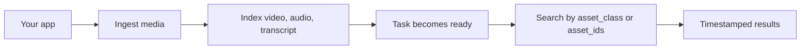

raidzero media 只有一个核心循环:提交一个资产,等待索引,然后
使用应用程序已经在使用的同一组 ID 与范围,搜索已索引的媒体。



## 1. 资产源自你的系统

每个摄取请求都包含你的 `asset_id`。这让媒体 API 能轻松回连到你的
数据库、CRM、支持工单、客户工作区或内部对象模型。

```ts
await client.ingest({
  source: "url",
  asset_id: "video_123",
  asset_class: "customer_acme",
  url: "https://example.com/recording.mp4",
});
```

## 2. 资产分类决定搜索范围

`asset_class` 是公开的分组原语。请使用它来表示你的产品最关心的边界。

好的例子:

- 一位终端客户
- 一个工作区
- 一个项目
- 一个代码仓库
- 一组支持通话

<Warning>
  如果你构建面向客户的搜索,建议优先使用 `asset_class` 或显式的 `asset_ids`。
  全局搜索应当是一项明确的产品决策。
</Warning>

## 3. 类型决定可搜索的维度

`types` 控制你索引或搜索的维度。

| 类型 | 适用场景 |
| --- | --- |
| `video` | 关注视觉内容时。 |
| `audio` | 关注声音、说话人或声学线索时。 |
| `transcript` | 关注口语内容和文本检索时。 |

你可以组合多种类型:

```ts
types: ["video", "audio", "transcript"]
```

## 4. 索引是异步的

摄取会快速返回一个 `task_id`。当任务进入 `ready` 状态后,资产即可被搜索。

```ts
const ingest = await client.ingest(request);
const task = await client.pollTask(ingest.task_id);
```

任务轮询会返回资产 ID、资产分类、已索引的类型、状态,以及索引失败时的错误信息。

## 5. 搜索返回带时间戳的匹配项

搜索结果包含 `start_ms` 与 `end_ms`,因此你的界面可以直接跳到匹配时刻。

```json
{
  "asset_id": "video_123",
  "score": 0.84,
  "start_ms": 42000,
  "end_ms": 58000,
  "match_type": "transcript"
}
```

使用 `threshold` 控制严格程度。值越高,返回的匹配越少,但置信度越高。

## 6. 后端提供方细节保持隐藏

SDK 仅暴露 raidzero 的概念:

- `asset_id`
- `asset_class`
- `types`
- `threshold`

提供方的索引、提供方 ID 与类型映射由后端处理。

<Card title="TypeScript SDK" icon="code" href="/cn/sdks/typescript">
  查看完整的 TypeScript API 参考。
</Card>
