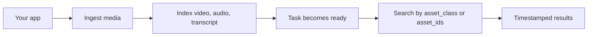

raidzero media tiene un bucle principal: enviar un recurso, esperar la indexación y luego
buscar en el contenido indexado con los mismos ID y ámbitos que tu aplicación ya utiliza.



## 1. Los recursos comienzan en tu sistema

Cada solicitud de ingestión incluye tu `asset_id`. Esto facilita unir la API de medios
con tu base de datos, CRM, ticket de soporte, workspace de cliente o modelo de objetos interno.

```ts
await client.ingest({
  source: "url",
  asset_id: "video_123",
  asset_class: "customer_acme",
  url: "https://example.com/recording.mp4",
});
```

## 2. Las clases de recursos definen el ámbito de búsqueda

`asset_class` es la primitiva pública de agrupación. Úsala para el límite que más le
importa a tu producto.

Buenos ejemplos:

- un cliente final
- un workspace
- un proyecto
- un repositorio
- una colección de llamadas de soporte

<Warning>
  Si construyes búsquedas para clientes, prefiere `asset_class` o `asset_ids` explícitos.
  La búsqueda global debe ser una decisión de producto explícita.
</Warning>

## 3. Los tipos eligen las superficies buscables

`types` controla qué superficies indexas o buscas.

| Tipo | Úsalo cuando |
| --- | --- |
| `video` | El contenido visual es importante. |
| `audio` | El sonido, los hablantes o las pistas acústicas son importantes. |
| `transcript` | Las palabras habladas y la recuperación de texto son importantes. |

Puedes combinar tipos:

```ts
types: ["video", "audio", "transcript"]
```

## 4. La indexación es asíncrona

La ingestión devuelve rápidamente un `task_id`. El recurso es buscable después de que la tarea
alcance el estado `ready`.

```ts
const ingest = await client.ingest(request);
const task = await client.pollTask(ingest.task_id);
```

El sondeo de la tarea devuelve el ID del recurso, la clase del recurso, los tipos indexados, el estado y cualquier
error si la indexación falla.

## 5. La búsqueda devuelve coincidencias con marca de tiempo

Los resultados de búsqueda incluyen `start_ms` y `end_ms` para que tu interfaz pueda saltar directamente
al momento coincidente.

```json
{
  "asset_id": "video_123",
  "score": 0.84,
  "start_ms": 42000,
  "end_ms": 58000,
  "match_type": "transcript"
}
```

Usa `threshold` para controlar la rigurosidad. Valores más altos devuelven menos coincidencias,
pero más fiables.

## 6. Los detalles del proveedor backend permanecen ocultos

El SDK solo expone los conceptos de raidzero:

- `asset_id`
- `asset_class`
- `types`
- `threshold`

Los índices, ID y mapeos de tipos del proveedor se gestionan en el backend.

<Card title="SDK de TypeScript" icon="code" href="/es/sdks/typescript">
  Consulta la referencia completa de la API en TypeScript.
</Card>
